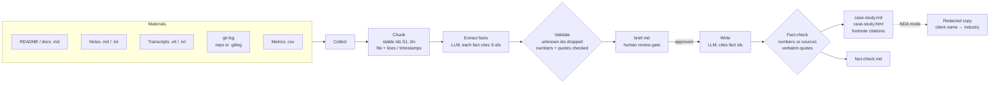

# case-study-generator

**Turn raw project materials into a client-ready case study where every claim cites its source and every number is fact-checked.**

[](https://github.com/Quantum-dev1/case-study-generator/actions/workflows/ci.yml)
[](LICENSE)


Agencies and freelancers sit on piles of proof: READMEs, meeting notes, call transcripts, git history,
KPI spreadsheets. Turning that into a case study usually means a day of copywriting, and LLM drafts are
risky: they round numbers, invent savings and paraphrase "quotes". This CLI does the writing **and** keeps
the receipts: each statement links back to a file and line range, numbers that do not appear in your
materials are removed, and a human approves the facts before anything is written.

```text
$ case-study write examples/bluefin-dispatch/output --approve
Fact-check: 23 statements, 27 numbers — 20 passed, 1 citation fixed, 2 removed
  removed (results): number "83%" not found in any source
  removed (results): number "$210,000" not found in any source
Wrote examples/bluefin-dispatch/output/case-study.md
Wrote examples/bluefin-dispatch/output/case-study.html
...
```

## How it works



## Features

- **Five kinds of input, one folder.** Markdown docs and notes, WebVTT and plain-text transcripts
  (speakers and timestamps kept), CSV metrics (each row becomes a self-describing line), and git history
  read directly from a local repo (`git log`, read-only) or from an exported `.gitlog` file.
- **Stable source ids.** Materials are chunked into `S1..Sn` with file, line range or transcript time range.
  Same materials, same ids, so briefs and recorded runs stay valid.
- **Facts with citations, validated.** The LLM extracts facts per batch of chunks; a fact citing an id it
  was not given is dropped, a fact whose numbers are not in its cited chunks is unticked with a warning,
  and a "quote" that is not verbatim in the transcript is unticked too.
- **Human review gate.** `brief.md` is a checklist the account manager edits: untick, reword, add
  `(editor)` statements, leave notes for the writer. `write` refuses to run until the brief is approved,
  and it reads your edits back.
- **Writer cites facts, not vibes.** The writer must reference fact ids; the tool maps them to sources
  and renders numbered footnotes with the exact location and the most relevant source line.
- **Number fact-check.** Every number in the output (`1,200`, `1.2k`, `40%`, `40 percent`, `$1.5M`, `3x`) is
  normalised and looked up in the sources. Found in a cited source: pass. Found only in another source:
  the citation is added. Found nowhere (hallucinated, rounded or derived): the statement is removed and
  listed in `fact-check.md`. The featured quote must be verbatim.
- **NDA mode.** `--nda` replaces the client name and aliases with an industry description
  ("a regional freight carrier"), plus any people or product names you list, everywhere: body, quote,
  attribution, footnote excerpts and file paths. Output is scanned afterwards; if any configured name
  survives, nothing is written.
- **Any OpenAI-compatible endpoint.** OpenAI, Azure OpenAI, OpenRouter, Groq, Together, Mistral, or a
  local vLLM / Ollama / LM Studio server. Configured by environment variables; no keys in files.
- **Record and replay.** `--record cassette.json` saves every LLM response by step; `--replay` reruns the
  whole pipeline offline and deterministically (demos, CI, prompt tweaks without paying twice).
- **Zero runtime dependencies.** Node.js 20+ standard library only; standalone HTML with light/dark styles.

## Quick start

```bash
git clone https://github.com/Quantum-dev1/case-study-generator.git
cd case-study-generator
npm install && npm run build

# 1. Try it offline on the bundled fictional project (no API key needed)
node dist/bin.js run examples/bluefin-dispatch/materials -o out \
  --replay examples/bluefin-dispatch/cassette.json --approve
open out/case-study.html

# 2. Use it on your own materials with a live model
export CSG_BASE_URL=https://api.openai.com/v1   # any OpenAI-compatible endpoint
export CSG_MODEL=gpt-4o-mini
export CSG_API_KEY=...                           # from your provider, never commit it

node dist/bin.js brief ./my-project -o ./my-project-out
# review ./my-project-out/brief.md, set "approved: true"
node dist/bin.js write ./my-project-out
node dist/bin.js write ./my-project-out --nda    # optional redacted copy
```

Once published to npm the binary is `case-study` (`npx case-study-generator ...`).

## Configuration

### Project config

Put `case-study.config.json` in the materials folder (or pass `--config`):

```json
{
  "project": "Bluefin Dispatch: dispatch console and driver app",
  "agency": "Lumen Works",
  "client": {
    "name": "Bluefin Freight",
    "aliases": ["Bluefin", "BFF"],
    "industry": "a regional freight carrier"
  },
  "redact": { "Dana Whitfield": "Client executive" },
  "git": ["../dispatch-platform"],
  "audience": "Operations leaders at mid-size logistics companies. Keep it under 400 words."
}
```

| Field | Required | Purpose |
| --- | --- | --- |
| `project` | yes | Project name; also the fallback title |
| `client.name`, `client.industry` | yes | Client name and the neutral description used in NDA mode |
| `client.aliases` | no | Other spellings to redact (short names, tickers, domains) |
| `redact` | no | Extra names → replacements (people, product names) |
| `git` | no | Local repositories to read `git log` from (relative to the config file) |
| `agency` | no | Shown as "Delivered by …" |
| `audience` | no | Default writer guidance (pre-filled in the brief's notes) |

### Environment

| Variable | Default | |
| --- | --- | --- |
| `CSG_BASE_URL` | — | Base URL of an OpenAI-compatible API, e.g. `http://localhost:11434/v1` |
| `CSG_MODEL` | — | Model name |
| `CSG_API_KEY` | — | Sent as `Authorization: Bearer …` when set |
| `CSG_TEMPERATURE` | `0.2` | |
| `CSG_TIMEOUT_MS` | `120000` | Per request |
| `CSG_MAX_RETRIES` | `3` | Exponential backoff on 408/409/425/429/5xx and network errors |
| `CSG_JSON_MODE` | `1` | Set `0` if your server rejects `response_format` |
| `CSG_CONCURRENCY` | `3` | Parallel extraction requests |

See [`.env.example`](.env.example).

## Usage

```text
case-study brief <materials-dir> [options]   collect → chunk → extract facts → brief.md
case-study write <out-dir> [options]         approved brief → case study (md + html) → fact-check
case-study run <materials-dir> [options]     brief, then write (needs --approve to skip review)

  -o, --out <dir>           output folder (default: ./case-study-out)
  -c, --config <file>       config file (default: <materials-dir>/case-study.config.json)
      --approve             treat the brief as approved (skip the human review gate)
      --nda                 redact client names; writes case-study.nda.* files
      --record <file>       call the live endpoint and save responses to a cassette
      --replay <file>       run offline from a recorded cassette (no network)
      --concurrency <n>     parallel extraction requests
      --max-chunk-chars <n> soft chunk size (default: 1200)
```

### Supported materials

| File | Treated as | Citation looks like |
| --- | --- | --- |
| `*.md`, `*.markdown` | document, split at headings | `notes/discovery.md, lines 5–11` |
| `*.txt` | transcript if most lines are `Speaker: …` or `[00:01:10] …`, otherwise document | `call.txt, 00:00:05–00:01:30` |
| `*.vtt` | transcript (WebVTT cues, `<v Speaker>` tags) | `kickoff.vtt, 00:00:04–00:01:13` |
| `*.csv` | metrics; header + each row as `column: value; …` | `metrics/kpis.csv, lines 2–6` |
| `*.gitlog` | git history exported with `git log --date=short --pretty=format:'%h\|%ad\|%an\|%s'` | `repo.gitlog, lines 1–17` |
| `git` repos in config | same, read live with `git log` | `git:repo, lines …` |

Git history also yields a deterministic summary chunk ("29 commits between 2025-02-12 and 2025-05-20 by
4 contributors") so those numbers are citeable.

### Reviewing the brief

```markdown
## Results

- [x] F18: Morning planning is down to about 25 minutes for the whole fleet. (S15)
- [x] F19: The on-time delivery rate reached 94%. (S15)
- [x] F22: Customer status calls fell from 120 to 30 per day. (S8)
- [ ] F23: Customer status calls fell by 75% after launch. (S8) <!-- WARNING: number "75%" not found in cited sources -->
```

Untick to exclude, edit text in place, add `- [x] The team was four engineers (editor)` for facts that are
not in the materials (they are cited as an editor note). Free text under **Notes for the writer** is passed
to the writer. Then set `approved: true`.

### As a library

```ts
import { buildBrief, writeCaseStudy, loadConfig, OpenAICompatibleLLM, optionsFromEnv } from "case-study-generator";

const llm = new OpenAICompatibleLLM(optionsFromEnv());
const config = await loadConfig("./materials");
await buildBrief({ materialsDir: "./materials", outDir: "./out", config, llm });
const { report } = await writeCaseStudy({ outDir: "./out", llm, approve: true });
console.log(report.removed, "statements removed by the fact-check");
```

Lower-level pieces (`collect`, `chunkDocuments`, `validateFacts`, `factCheck`, `createRedactor`,
`renderHtml`, `extractNumbers`) are exported too. Implement the small `LLM` interface (`complete()` + `usage`) to plug in
anything else.

## Example

[`examples/bluefin-dispatch`](examples/bluefin-dispatch) is a **fictional** project (Bluefin Freight,
Lumen Works and all people are made up): a dispatch console and driver app for a 64-truck carrier.
Materials: a repo README, discovery and retro notes, two call transcripts (`.vtt` and `.txt`), a KPI CSV
and an exported git log.

About the LLM responses: no live model was used to build this example. The responses in
[`cassette.json`](examples/bluefin-dispatch/cassette.json) were written by hand in the format a model
returns, and replayed with `--replay`. **They deliberately contain typical model mistakes** so the
checks have something to catch: an extracted fact with a derived "75%", a fact citing a non-existent
source, a paraphrased "quote", and a draft with an invented "$210,000" saving and a derived "83%
faster". Everything else in [`output/`](examples/bluefin-dispatch/output) (chunking, validation, brief,
fact-check, citations, redaction, HTML) is real tool output, reproducible offline with
`npm run examples` and verified by a golden test.

Excerpt from [`case-study.md`](examples/bluefin-dispatch/output/case-study.md):

```markdown
## Results

- Morning planning now takes about 25 minutes for the whole fleet, down from about 2.5 hours.[^1][^8]
- On-time delivery rose from 81% to 94%.[^5][^8]
- Customer status calls fell from 120 to about 30 per day.[^11][^12]
- 61 of 64 drivers were using the app within two weeks of the all-depot rollout.[^4]

> “For the first time in years, my dispatchers go home on time and the phones are quiet.”
> — Dana Whitfield[^12]

[^5]: **S11** · notes/discovery-notes.md, lines 13–18 — “1. Late departures cascade into missed delivery windows (on-time rate 81% last quarter).”
[^8]: **S15** · notes/launch-retro.md, lines 15–19 — “On-time delivery rate reached 94%.”
```

From [`fact-check.md`](examples/bluefin-dispatch/output/fact-check.md):

```markdown
- **REMOVED** (results): Planning is 83% faster than before.
  - number "83%" not found in any source
- **RECITED** (results): On-time delivery rose from 81% to 94%.
  - "81%" found in S11, citation added
- **REMOVED** (results): The empty-mile share fell from 18% to 11%, saving an estimated $210,000 a year in fuel.
  - number "$210,000" not found in any source
```

And the NDA version ([`case-study.nda.md`](examples/bluefin-dispatch/output/case-study.nda.md)) opens with
*"A regional freight carrier cut morning dispatch planning from 2.5 hours to 25 minutes"*.

## Architecture

```text
src/
  collect/      markdown, transcript (vtt/txt), csv, git → RawDocument[] with line numbers
  chunk.ts      RawDocument[] → Chunk[] with stable ids and locations
  extract.ts    LLM fact extraction per batch + validation (ids, numbers, verbatim quotes)
  brief.ts      render/parse brief.md (the human review gate)
  write.ts      LLM writer → structured CaseStudy citing fact ids → source ids
  factcheck.ts  number + quote verification, citation repair, report
  numbers.ts    number extraction/normalisation (1,200 = 1.2k; 40% = 40 percent)
  redact.ts     NDA redaction + leak scan
  render.ts     Markdown footnotes + standalone HTML
  pipeline.ts   buildBrief / writeCaseStudy (files in the out dir)
  llm/          OpenAI-compatible client, record/replay cassettes, JSON parsing
  cli.ts        argument parsing (node:util parseArgs)
```

Output folder after a full run: `sources.json` (chunks), `facts.json` (extracted and dropped facts),
`brief.md`, `case-study.{md,html,json}`, `fact-check.{md,json}`, plus `*.nda.*` in NDA mode.

### What the fact-check does and does not catch

- Catches: numbers that are invented, rounded ("about 40%" when the source says 41.7%), converted or
  derived (percent change computed from before/after), citations to the wrong chunk, fake quotes.
- Removes whole statements, never half-sentences, so the text stays grammatical.
- Does not yet verify non-numeric claims semantically ("the client doubled its team" without digits) or
  numbers written as words ("three depots"). The brief review exists for exactly that.

## Roadmap

- [ ] Redact client names *before* sending text to the LLM (local-only NDA mode)
- [ ] LLM entailment check for non-numeric claims, with the same remove-or-recite policy
- [ ] Numbers written as words ("three", "a dozen")
- [ ] PDF and DOCX inputs; Jira/Linear CSV exports as a first-class source
- [ ] Token and cost estimate before a live run
- [ ] Templates for different formats (one-pager, LinkedIn post, sales deck outline)
- [ ] Multilingual output with citations preserved

## Contributing

Issues and pull requests are welcome. See [CONTRIBUTING.md](CONTRIBUTING.md): tests run without
network (mocked LLM and cassettes), and the bundled example is a golden test.

```bash
npm install
npm run typecheck && npm test && npm run build
```

## License

[MIT](LICENSE) © Quantum Dev

---

Built by [Quantum Dev](https://quantumdevteam.com) — we build web platforms, mobile apps and AI agents. Need something like this for your business? [Book a call](https://cal.com/aleksandr-ganus/30m).
